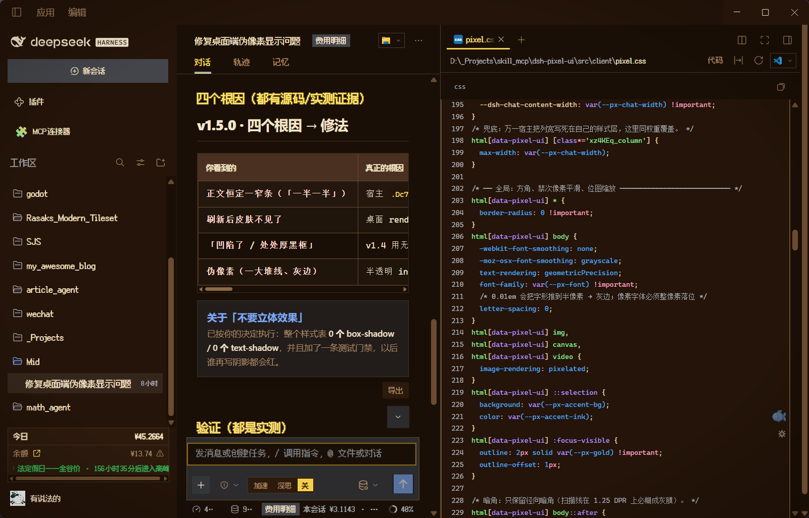
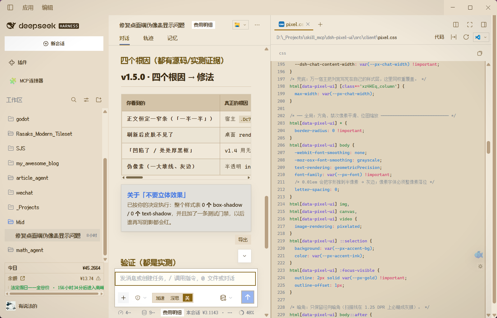
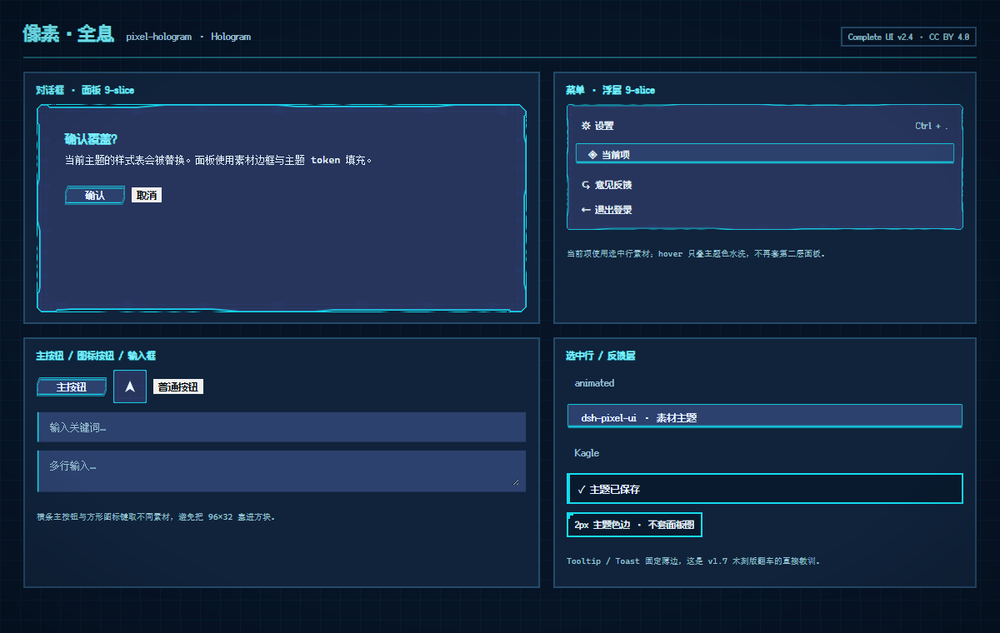

<p align="center">
  
</p>

# 🪵 dsh-pixel-ui

> 把 DeepSeek Harness 换成像素 RPG 风：九套主题、全套控件与光标重绘，一键切回现代 UI。


## 特性

- **九套主题**：木屋、羊皮纸、暖阳、终端绿、全息、南瓜灯、便签本、云石、秘银；七深色 + 两浅色。
- **不只是换背景**：23 个宿主 token 覆盖侧栏、气泡、菜单、输入区、提示底；连按钮、输入框、表格、滚动条、光标一起重做。
- **两种质感**：前四套完全平面（2px 描边、棋盘抖动、阶梯动效）；后五套用 Complete UI 的真实 PNG 9-slice（构建期内联，离线可用）。
- **记得住**：主题偏好同时写宿主文件与 localStorage，DSH Desktop 随机端口重启也不会失忆。
- **可退出**：设置里选「现代默认」，立即回到原生 UI，不残留样式。

## 主题

| 主题 | id | 风格 |
| --- | --- | --- |
| 像素·木屋 | `pixel-wood` | 深木 + 金（默认） |
| 像素·羊皮纸 | `pixel-paper` | 浅色纸面 + 金棕 |
| 像素·暖阳 | `pixel-warm` | 暖木 + 橙 |
| 像素·终端绿 | `pixel-retro` | 墨绿 + 荧光绿 |
| 像素·全息 | `pixel-hologram` | 深蓝 + 青色 9-slice |
| 像素·南瓜灯 | `pixel-pumpkin` | 暗橙藤蔓框 + 暖金 |
| 像素·便签本 | `pixel-papernote` | 活页纸 + 铅笔光标 |
| 像素·云石 | `pixel-marble` | 板岩 + 白石框 + 钢青 |
| 像素·秘银 | `pixel-mithril` | 靛紫 + 银蓝薄框 |

| 木屋 | 羊皮纸 | 全息 |
| --- | --- | --- |
|  |  |  |

更多截图见 [`assets/`](assets/)。

## 安装

```bash
# npm（推荐）
dsh plugin add dsh-pixel-ui

# 或 GitHub Releases 的 tgz
dsh plugin add ./dsh-pixel-ui-1.13.1.tgz

# 或源码 link
dsh plugin add github:zhang66633/dsh-pixel-ui
```

安装后重启 dsh / DSH Desktop。DSH Desktop 用户可在托盘 **Open DSH Terminal** 里执行同一命令。

## 使用

1. 首次安装默认激活「像素·木屋」；之后恢复上次选择。
2. **设置 → 通用设置 → 像素主题**，十个按钮切换九套皮肤或「现代默认」。
3. 选「现代默认」即整体退出；选择会记住，刷新/重启不复活。

主题偏好位于 `$DSH_HOME/storages/dsh-pixel-ui/preference.json`，浏览器 localStorage 只做同端口镜像。

## 兼容

- **DSH**：目标 `0.2.1-rc.5`（真实宿主九套验证）；声明范围 `0.1.0-rc.6` ~ `0.2.x`，`engines.dsh` / dsh peers / `dshReleases` 三处一致。
- **DSH Desktop**：2.0.x，web 兼容模式/高级模式均可。
- **浏览器**：现代 Chromium / Firefox；CSS 变量 + SVG 光标 + 本地字体。
- **无障碍**：九主题全部通过 WCAG AA；`prefers-reduced-motion` 下关闭动效。

## 开发

```bash
npm install
npm run build   # 构建 lib/client.js，CSS 与 9-slice PNG 内联
npm test        # compat + host + client + contrast
```

开发文档在 [`docs/dev/`](docs/dev/)（计划 / 迭代 / 踩坑）。宣传片与状态录像在 [`promo/`](promo/)。

## 许可

[MIT](./LICENSE) © 2026 zhang66633。

- 字体：fusion-pixel（MIT）、Press Start 2P（SIL OFL），随包分发。
- Complete UI 切片 © Crusenho Agus Hennihuno，[CC BY 4.0](https://creativecommons.org/licenses/by/4.0/)；五套素材的署名见
  [`hologram`](assets/complete-ui/hologram/ATTRIBUTION.md) ·
  [`pumpkin`](assets/complete-ui/pumpkin/ATTRIBUTION.md) ·
  [`papernote`](assets/complete-ui/papernote/ATTRIBUTION.md) ·
  [`marble`](assets/complete-ui/marble/ATTRIBUTION.md) ·
  [`mithril`](assets/complete-ui/mithril/ATTRIBUTION.md)。

安全问题请走 GitHub **security advisory**，不要发公开 issue。
