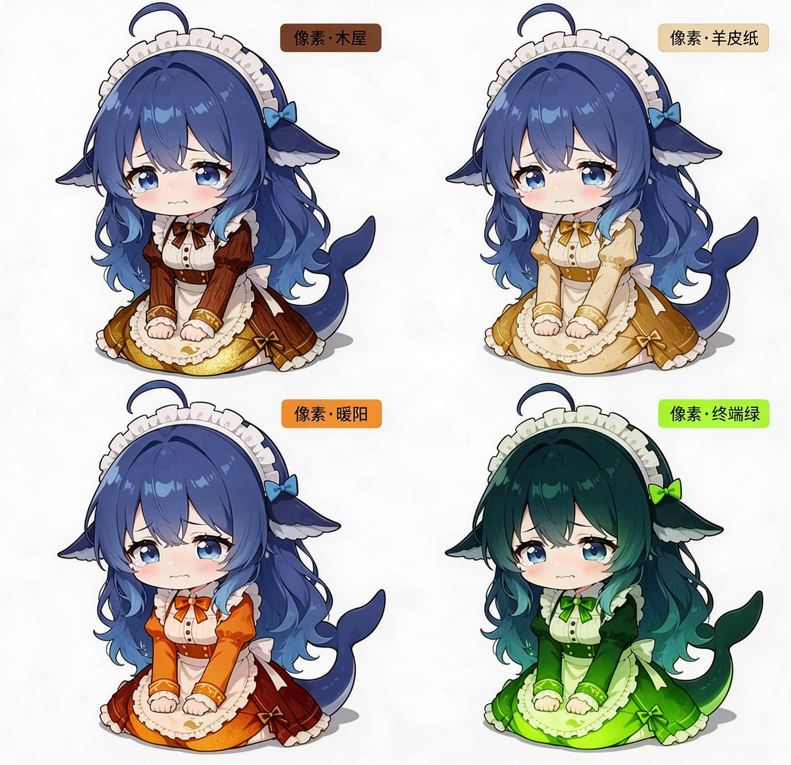
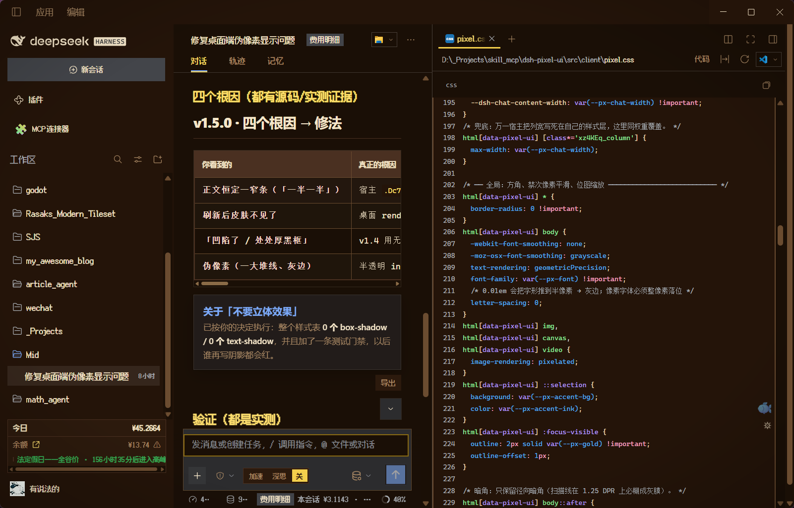
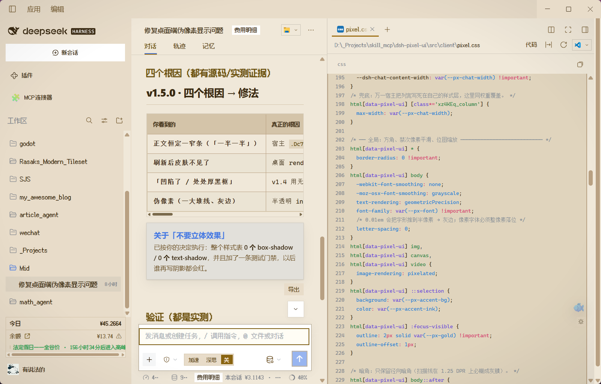
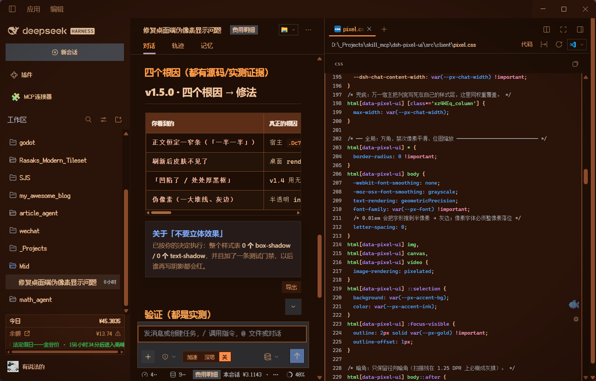
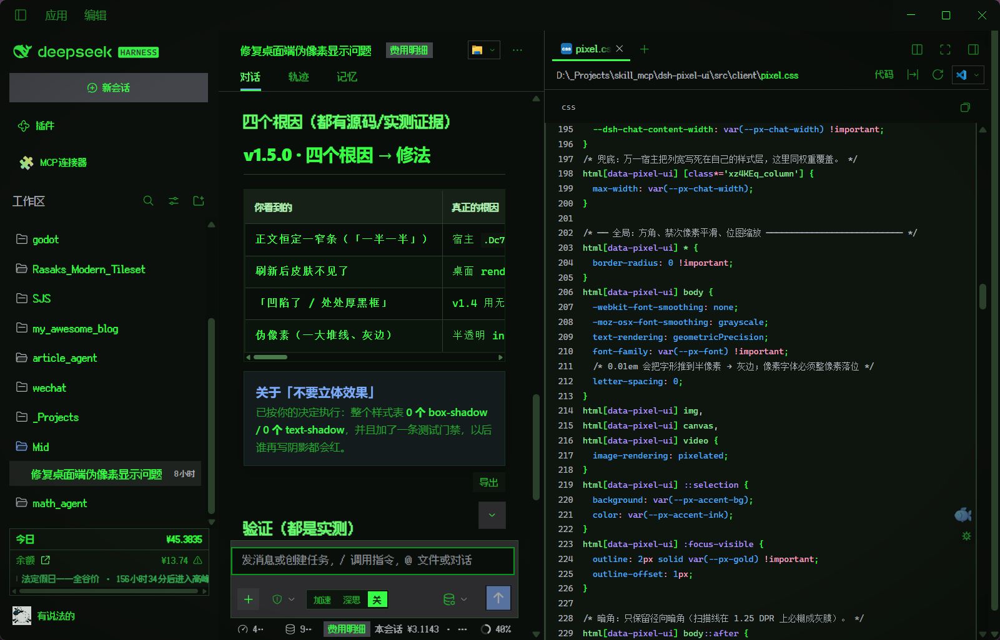
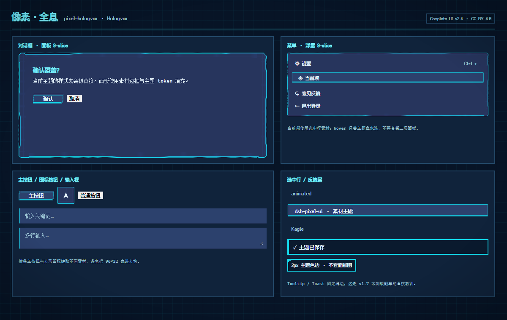
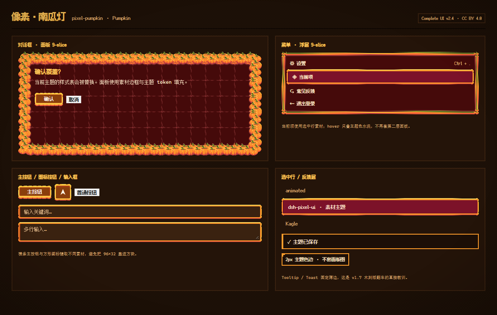
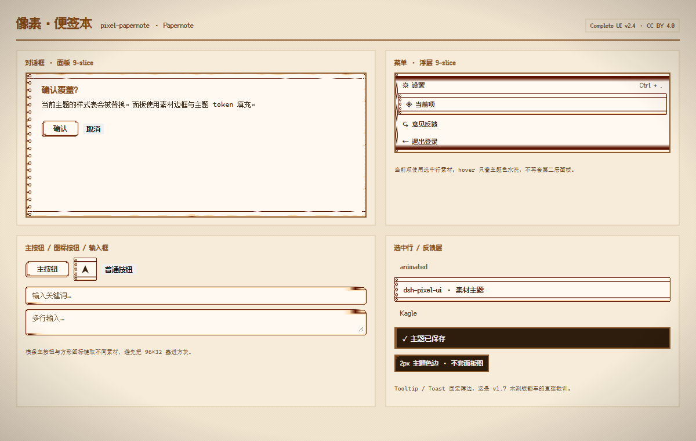

<p align="center">
  
</p>

# 🪵 dsh-pixel-ui

> DeepSeek Harness 像素皮肤（Agent Xi 风格）：七个主题一键切换——像素·木屋 / 像素·羊皮纸 / 像素·暖阳 / 像素·终端绿 / 像素·全息 / 像素·南瓜灯 / 像素·便签本，随时可切回现代默认 UI。


---

## Overview

`dsh-pixel-ui` 是一个**皮肤插件**，把 dsh Web GUI 重皮肤成像素 RPG 风：

1. **七个主题**：像素·木屋（深木 + 金）、像素·羊皮纸（浅色纸面 + 金棕）、像素·暖阳（暖橙木）、像素·终端绿（终端绿字）、像素·全息（真 PNG 9-slice 深蓝全息框 + 青色描边）、像素·南瓜灯（暗橙藤蔓框 + 暖金）、像素·便签本（浅色活页纸 + 铅笔光标）；
2. **像素质感**：前四套**完全平面**——整像素 2px 描边、平涂色块的一档明度差、2px 棋盘抖动、手绘 SVG 像素图形（对勾/单选点/下拉箭头/光标），零 `box-shadow` 与 `text-shadow`；后三套是**真素材分支**，使用 Complete UI 素材自带的浮雕边框（CC BY 4.0，见下方授权），全息/南瓜灯/便签本的对话框、菜单、主按钮、输入框、选中行各取不同的 9-slice 策略；
3. **宿主表面一起换色**：主题 token 从 17 个扩到 23 个，新增用户气泡、弹层菜单、输入区、选择键、提示底等宿主自绘表面的颜色，气泡/输入区不再留着宿主默认蓝；
4. **细节与动感**：所有动效走 `steps()` 阶梯（80/140/220ms），按下 1px 位移、页签下划线逐格生长、思考中闪烁光标、运行中左条呼吸、toast 三帧进入；另有主题化勾/点、代码块终端顶栏、表格斑马纹、吸顶标题底线、滚动条握把、纸面专用深色光标。`prefers-reduced-motion` 下一律关闭；
5. **桌面端友好**：内容列宽随视口撑开（`clamp(680px, 64vw - 140px, 1200px)`，窄屏仍是宿主原本的 680px），皮肤选择在 `dsh-app://` 页面上也能恢复；素材在构建期转成 data URI 内联，换素材只需重新 build + 刷新页面，不必重启宿主。

**适合谁**：想要像素风 / 星露谷风 / 复古终端外观的 dsh 用户；想给会话截图加一点氛围感的博主和开发者。


## Themes

### 像素·木屋 · `pixel-wood`

> 深色 · 深木 `#1A0F06` + 金 `#F4D03F`（默认主题）



### 像素·羊皮纸 · `pixel-paper`

> 浅色 · 纸面 `#F0E8D8` + 深金棕 `#A07000`



### 像素·暖阳 · `pixel-warm`

> 深色 · 暖木 `#1E0E04` + 橙 `#FF8C42`



### 像素·终端绿 · `pixel-retro`

> 深色 · 墨绿 `#0A0E0A` + 绿 `#33FF33`



### 像素·全息 · `pixel-hologram`

> 深色 · 深蓝 `#071426` + 青色 `#14DCEE`；对话框/菜单/主按钮/输入框/选中行/滚动条使用 **真实 PNG 9-slice**（Complete UI · Hologram，CC BY 4.0）。

- 面板：`panel.png` 96×96 → `border-image-slice:24 fill`；深蓝网格底 + 青色描边；
- 主按钮：`button-primary.png` 96×32 → `slice:8 20`、`border-width:6px 10px`；hover/press/lock 三态；
- **图标按钮**：发送/关闭等 `only-child svg` 的主按钮改用 32×32 `Frame_Lite`，不再把 96×32 横条塞进方块；
- 输入框：`input.png` 32×32 → `slice:10 fill`；选中行：`select-bar.png`；滚动条：`scroll-handle.png`；
- **Tooltip / Toast 保持扁平薄边**（2px 青色），不再套 10px 面板框——这是木刻版本翻车的直接原因。



*图为静态组件预览（真实 CSS + 素材，headless 渲染；不是实机会话截图）。*

> 素材：Complete UI Essential Pack v2.4 · `06_Hologram_Theme` by **Crusenho Agus Hennihuno**，CC BY 4.0；
> 只取 8 张切片，完整署名与许可证在
> [`assets/complete-ui/hologram/ATTRIBUTION.md`](assets/complete-ui/hologram/ATTRIBUTION.md)。
> 全息是**第五套**，和南瓜灯/便签本同属真素材分支；前四套仍保持零立体、零阴影。

### 像素·南瓜灯 · `pixel-pumpkin`

> 深色 · 近黑 `#170D06` + 南瓜橙 `#FF9E2C` + 暖金 `#FFC85E`；对话框用 96×96 的藤蔓边框，菜单/主按钮/输入框/选中行各用一张 32×32 或 96×32 的切片。

- **对话框**：`frame_full.png` 96×96 → `slice:30 fill`；藤蔓边框按 `round` 平铺，南瓜不会被横向拉长；
- **菜单**：`frame_simple.png` 32×32 → `slice:12`，小浮层不用大藤蔓（避免“门板”）；
- **主按钮**：`button_long1/2/3.png`（96×32，rest/hover/press 三态）→ `slice:6 8 12 8`、`border-width:6px 8px 10px 8px`；
- **图标按钮**：`button_simple1.png` 32×32 → `slice:4 4 10 4`；发送键不再挤压横条按钮；
- **输入框 / 选中行**：`text_field.png` / `dropdown.png` 32×32 → `slice:6 fill`；选中行用素材自带的深红底，文字保持奶油色。



*图为静态组件预览（真实 CSS + 素材，headless 渲染；不是实机会话截图）。*

> 按钮与输入框的填充色从 `#BF5F16` 加深到 `#8A3E0C` / `#3A2210`，保证奶油色字与占位符在素材填充上 ≥4.5:1；藤蔓、金边与高光未改（见 ATTRIBUTION 的 Modifications）。

> 素材：Complete UI Essential Pack v2.4 · `09_Pumpkin_Theme`，CC BY 4.0；
> 源文件映射与署名在 [`assets/complete-ui/pumpkin/ATTRIBUTION.md`](assets/complete-ui/pumpkin/ATTRIBUTION.md)。

### 像素·便签本 · `pixel-papernote`

> 浅色 · 纸面 `#F2E6D2` + 奶油便签 `#FFF9F1` + 深棕 `#8C5A2C`；对话框是一张带装订孔与撕边的活页纸，鼠标指针换成 32×32 铅笔。

- **对话框**：`FrameStandard01.png` 96×96 → `slice:12 8 12 18`、`border-image-repeat:stretch round`；左边 18px 是装订孔，按比例纵向平铺；
- **菜单 / 图标按钮 / 选中行**：`FrameLite01.png` 32×32 → `slice:6 fill`；选中行是一张包住整行的迷你便签；
- **主按钮**：`Button03/02.png`（96×32 / 64×32）→ 便签条 + 左下折角；文字用深棕而不是宿主默认的奶油色；
- **输入框**：`Textfield01.png` 64×32 → `slice:4 4 6 4`；**光标**：`CursorPencil01.png`，铅笔贯穿按钮/输入框/正文，热区在笔尖；
- 便签纸面与页面同色，额外用 2px 墨线（`--pxa-outline`）把“纸”钉出来，避免菜单看起来像悬浮文字。



*图为静态组件预览（真实 CSS + 素材，headless 渲染；不是实机会话截图）。*

> 素材：Complete UI Essential Pack v2.4 · `11_Papernote_Theme`，CC BY 4.0；
> 源文件映射与署名在 [`assets/complete-ui/papernote/ATTRIBUTION.md`](assets/complete-ui/papernote/ATTRIBUTION.md)。

> 前四套的截图取自 DSH Desktop（1920×1200 @125% 缩放）；全息 / 南瓜灯 / 便签本目前用上面的
> 静态组件预览，实机截图待补拍。截图由插件市场按本仓库根的
> [`screenshots.json`](screenshots.json) 读取——换图只推自己的仓库，不必提 PR。

## Motion & detail

| 层 | 细节 | 动效 |
| --- | --- | --- |
| 按钮 | 主按钮主题化实心块 + 2px 描边；hover 叠 2px 棋盘 | 80ms `steps(2)`；按下 1px 位移 |
| 页签 | 金色下划线，2→3px | 140ms `steps(4)` 的 `scaleX` |
| 会话 / 项目行 | 选中行 hover 提亮；未选行补 2px 金色左条 | 像素手 cursor 全覆盖（含子元素） |
| 面板导航（插件/市场…） | hover 用 `--px-wood-mid`，纸面不再和侧栏同色；当前项木色底 + 金左条 | hover 再叠 2px dither |
| 页脚菜单（设置/反馈/退出） | 菜单项木色底 + 3px 金左条 + dither；危险项保留红条 | 80ms `steps(2)`；`kbd` 只改字体不撑宽 |
| 设置页左导航 | 对话框内 hover 用 `--px-wood-warm`（避免和面板同色）；navList 横向隐藏 | — |
| 输入 | 2px 金框、方块光标、hover 提亮 | 边框 80ms `steps(2)` |
| 选择件 | 勾/点按主题换色（纸面用纸白） | 80ms `steps(2)` |
| 代码块 | 终端顶栏、左侧金色运行条、inline code 底色 | — |
| 表格 | 斑马纹 + 行 hover 木色 | — |
| 吸顶标题 | 2px 底线 + 2px 抖动 | — |
| 思考中 | 宿主 shimmer 改 4 帧，左侧 2px 光标闪烁 | 1.2s `steps(1)` / `steps(4)` |
| 运行中 | 终端左侧运行条呼吸 | 1.1s `steps(2)` |
| 状态点 / 转圈 | 方点闪烁；圆形 spinner 改 8 帧旋转 | `steps(8)` |
| Toast | 2px 框 + 左侧金条 | 220ms `steps(3)` 进入 |
| 滚动条 | 4×2 像素握把 | hover / active 换色 |
| 无障碍 | `prefers-reduced-motion` 下一律关闭 | — |

## Compatibility

| 项 | 支持范围 |
| --- | --- |
| dsh 生态 | `0.1.0-rc.6` ~ `0.2.x`（ThemeService `register`/`setTheme` + `settings.general.item` 槽位；`0.2.1-rc.3` 已按源码逐条核对，并用 0.2.1 真实的 `ThemeRuntime` 跑通注册/恢复/切换契约；见 `docs/dev/迭代记录.md`） |
| 兼容声明 | 同时声明 `engines.dsh` 与 `@deepseek-ai/dsh-*` peers：0.2.1 的 app-boot 优先读 `engines.dsh`，dshmarket 的发现页把两者取交集；任一判定器都能过 |
| DSH Desktop | 2.0.x（web 兼容模式/高级模式均适用） |
| 模式 | 五深色 + 两浅色（`colorScheme` 按主题声明） |
| 浏览器 | 现代 Chromium / Firefox（`localStorage` + CSS 变量 + SVG 光标） |
| 字体 | fusion-pixel 12px zh_hans（MIT）+ Press Start 2P（OFL），随包分发 |
| 对比度 | 七主题全部通过 WCAG AA（正文 ≥4.5:1、非文本 ≥3:1，`npm run test:contrast` 门禁） |

## Install / Uninstall

### Install

npm（推荐）：

```bash
dsh plugin add dsh-pixel-ui
```

GitHub Releases（无需 npm，同样开箱即用）：

```bash
# 下载 Releases 里的 dsh-pixel-ui-<version>.tgz
dsh plugin add ./dsh-pixel-ui-1.8.1.tgz
```

GitHub 源码（构建产物已随仓库提交，无需构建）：

```bash
dsh plugin add github:zhang66633/dsh-pixel-ui
```

本地开发（link 方式）：

```jsonc
// <profile>/package.json
{
  "dependencies": { "dsh-pixel-ui": "link:<仓库路径>" },
  "dsh": { "profile": { "bundles": ["dsh-pixel-ui"] } }
}
```

```bash
cd <profile> && pnpm install
```

安装后重启 dsh / DSH Desktop，皮肤才会进入 Loader 组合。

#### DSH Desktop 用户

1. 托盘右键 → **Open DSH Terminal**，在终端里执行 `dsh plugin add dsh-pixel-ui`（自动作用于当前 profile，如 `desktop`）；
2. 退出并重新打开 DSH Desktop。

#### 主题记忆（桌面端随机端口不再失忆）

DSH Desktop 默认每次启动随机分配本地 Web 端口，而浏览器 `localStorage` 按 origin（含端口）隔离——旧版本因此会在重启后忘记皮肤选择。v1.4.0 起（v1.5.0 起桌面端改走宿主 index 注入），最后一次选择的主题会同时写入宿主侧文件（`$DSH_HOME/storages/dsh-pixel-ui/preference.json`，经 `/dsh-pixel-ui/preference` 路由读写），与端口无关；`localStorage` 退化为同端口的快速镜像。无需任何配置，固定端口（`dsh-desktop.port`）现在只是可选项。

### Upgrade

- npm：重新运行 `dsh plugin add`（固定版本号）；
- 本地 link：`git pull` 后重新构建（`npm run build`），刷新浏览器。

### Disable

只从 `dsh.profile.bundles` 移除 `dsh-pixel-ui`（依赖可以保留）——皮肤不再注入，UI 回到现代默认。

### Uninstall

从 profile `package.json` 移除依赖与 bundles 条目，`pnpm install`。

## Quick start

1. 安装后重启 dsh / DSH Desktop；
2. 首次加载自动激活默认主题「像素·木屋」；
3. 设置 → 通用 → **像素主题**，八个按钮一键切换七个皮肤和「现代默认」；
4. 选「现代默认」（或外观行选 浅色 / 深色 / 跟随系统）即整体退出皮肤，选择会被记住，下次打开不复活。

最小可复现示例：安装 → 重启 → 木屋主题上身 → 切换到「像素·便签本」→ 对话框变成带装订孔的活页纸 → 输入框文字清晰可读 → 点「现代默认」→ 页面立即回到现代 UI → 刷新页面仍是现代 UI。

## Configuration

- **无配置项**：七个主题的 23 个 `--dsw-*` token 定义在 `src/client/index.js` 的 `THEMES`，像素质感与 9-slice 素材层在 `src/client/pixel.css`；
- **默认主题**：`pixel-wood`（仅首次安装时自动激活，之后尊重你的选择）；
- **持久化**：双层——宿主文件 `$DSH_HOME/storages/dsh-pixel-ui/preference.json`（权威，跨端口/跨浏览器）+ 浏览器 `localStorage` 的 `dsh-pixel-ui:theme`（同 origin 镜像）；
- 无环境变量、无敏感项。

## Permissions & data

- 宿主进程：**只读**本包内字体文件；在 `$DSH_HOME/storages/dsh-pixel-ui/` 下读写一个主题偏好 JSON（只注册 `/dsh-pixel-ui/fonts/*` 与 `/dsh-pixel-ui/preference` 两个路由，字体文件名白名单、主题 id 白名单，均无路径穿越）；三套素材主题的 PNG 在构建期已内联进 `lib/client.js`，宿主不再按路径读素材；
- 浏览器半边：注册主题 + 注入样式表 + 一个设置行；无网络请求、无遥测、不读凭据，只在 `localStorage` 存一个主题 id。

## Troubleshooting

| 现象 | 处理 |
| --- | --- |
| 皮肤没生效 | `dsh --profile <name> --dump-config`（DSH Desktop 终端里直接 `dsh --dump-config`）确认 `dsh-pixel-ui` 在树；设置 → 通用 → 像素主题 里选一个主题；node 半边改路由后必须重启，client 半边（含素材）刷新即可 |
| 想回现代默认 | 设置 → 通用 → 像素主题 → 点「现代默认」（或外观行选 浅色/深色/跟随系统） |
| 主题没记住 | 确认浏览器未禁用 `localStorage`；v1.4.0 起以宿主文件为权威（桌面端经 index 注入下发），检查 `$DSH_HOME/storages/dsh-pixel-ui/preference.json` 是否存在且内容合法 |
| 字体没加载 | 浏览器控制台（F12 → Network）看 `/dsh-pixel-ui/fonts/*` 是否 200 |
| 偏好路由 404 | 宿主还是旧版 node 半边：重启 DSH Desktop；未重启期间功能自动降级为 localStorage 记忆 |
| 素材主题显示成纯色块 | 说明浏览器加载的是旧 `lib/client.js`：`npm run build` 后硬刷新；素材已内联，不会再出现 404 |
| 回滚 | 从 `dsh.profile.bundles` 移除插件条目并 `pnpm install` —— profile 其余部分不受影响 |

## Development

```bash
npm install
npm run build    # 构建 lib/client.js（wire 格式，CSS 以文本内联，9-slice PNG 内联为 data URI）
npm test         # test:compat + test:host + test:client + test:contrast
```

- `scripts/check-compat.mjs`：`engines.dsh` / dsh peers / dshReleases 的声明门禁（0.2.1-rc.3 严格安装路径）
- `scripts/asset-inline.mjs`：把 CSS 里的 `url('pxasset:<theme>/<file>.png')` 换成 data URI，并用 `ASSET_DIRS` 白名单校验主题名
- `scripts/test-host.mjs`：node 半边（字体白名单 / 偏好路由读写与校验 / **确认没有素材路由** / dispose）
- `scripts/test-client.mjs`：browser 半边（加载真实 lib/client.js，覆盖注册、恢复矩阵、交互、渲染、动效门禁、**三套素材主题的内联 9-slice**、`data-pixel-asset` 开关、dispose）
- `scripts/audit-contrast.mjs`：七主题 WCAG 对比度门禁（改 palette 必跑；新增用户气泡 / 菜单面 / 输入区三对）

改动皮肤后重新构建并刷新浏览器即可；**素材已内联，新增素材主题不再需要重启宿主**。开发文档在 `docs/dev/`（计划 / 迭代 / 踩坑）。欢迎 PR；行为变更请同步更新 README。

## License & security

[MIT](./LICENSE) © 2026 zhang66633 · 字体：fusion-pixel（MIT）、Press Start 2P（SIL OFL）。
`pixel-hologram`（8 张）、`pixel-pumpkin`（8 张）、`pixel-papernote`（7 张）的 Complete UI 切片
© Crusenho Agus Hennihuno，[CC BY 4.0](https://creativecommons.org/licenses/by/4.0/)，
分别见 [`hologram`](assets/complete-ui/hologram/ATTRIBUTION.md) /
[`pumpkin`](assets/complete-ui/pumpkin/ATTRIBUTION.md) /
[`papernote`](assets/complete-ui/papernote/ATTRIBUTION.md) 的 ATTRIBUTION。

> 未收录 PixelPocketPhoneUI 的 PNG：该素材包只有 © IndigoLay 与 Unity Asset Store EULA，
> 没有随包再分发许可。若将来拿到书面许可，可按同一 `pxasset:` 流程接入（见 `docs/dev/踩坑记录.md` #13）。

安全问题请通过 GitHub **security advisory** 私下报告，不要发公开 issue。
