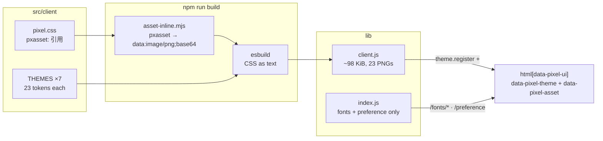
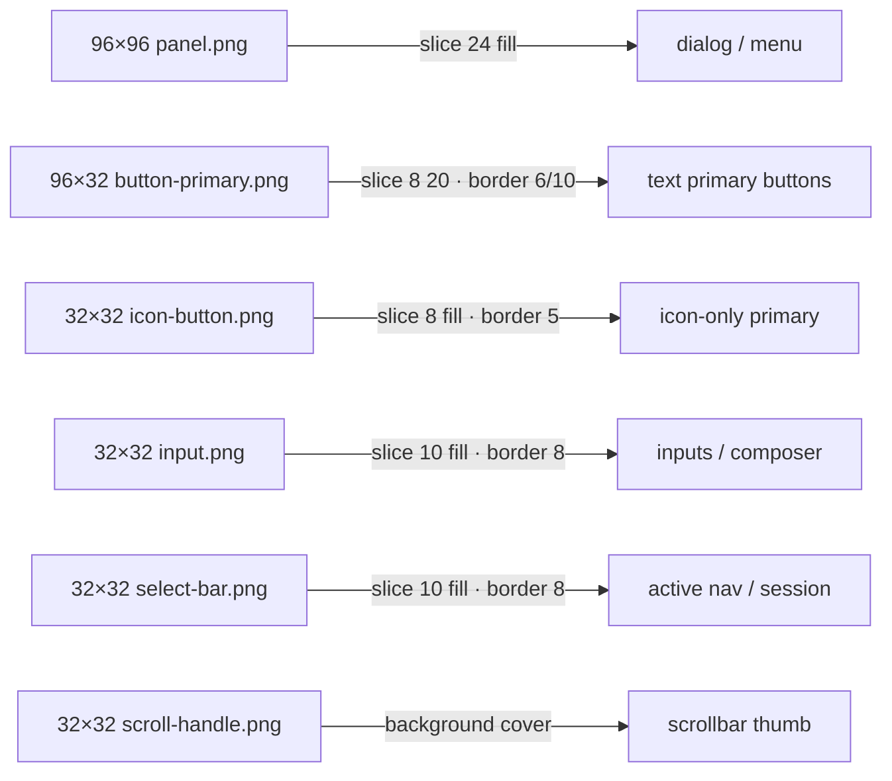
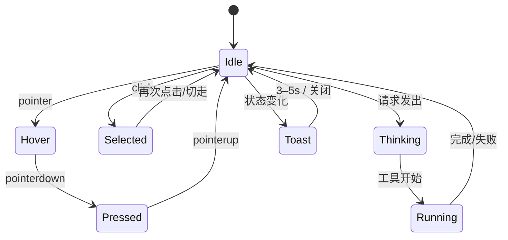
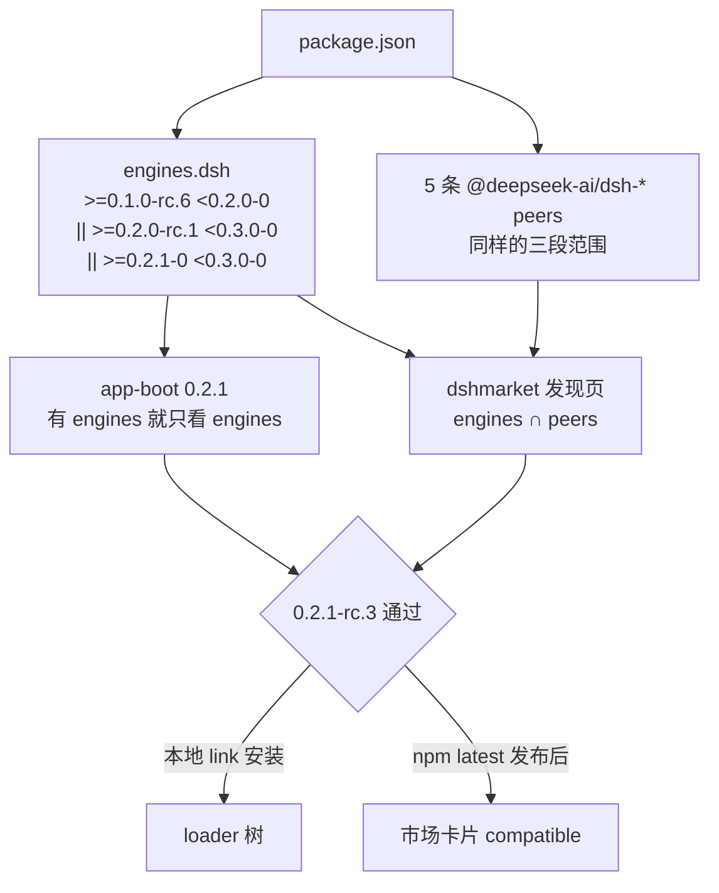
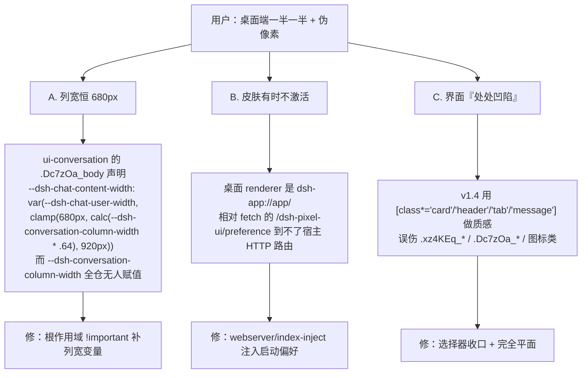
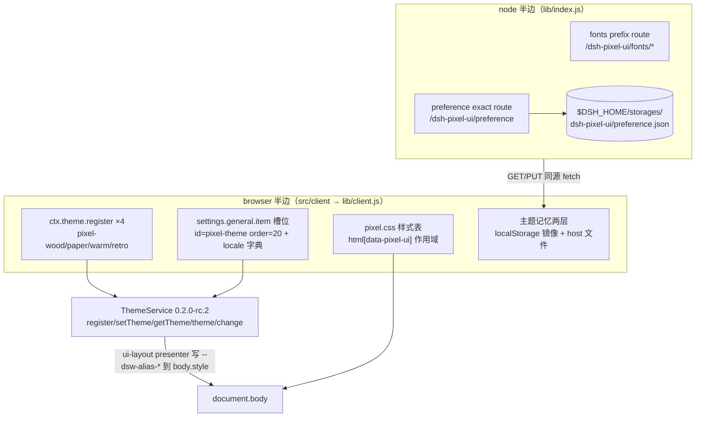

# 开发计划 · v1.9.0（第八套：像素·云石 · Complete UI Stone）

> 状态：代码/测试/组件板完成；待发布 1.9.0。

## 1. 背景

从剩余 10 套 Complete UI 主题里做了三套候选板（秘银/云石/卡带），用户选**云石**：
板岩 + 白石框 + 钢青，浅色控件和现有 7 套的色相/明度都不同；素材仍是 CC BY 4.0。

## 2. 目标

| # | 条件 | 判定 |
| --- | --- | --- |
| A | 新增第八套 `pixel-marble` | 8 个设置按钮 + 现代默认；中英文案；token 23 个齐全 |
| B | 白石框清晰不糊 | panel `slice:20 fill` + `repeat`；menu `slice:12 fill` + `repeat` |
| C | 浅色控件文字可读 | 按钮/输入框深墨字；选中行 `--pxa-select-ink` 独立控制 |
| D | 不回归 | `npm test` 全绿；对比度八主题 ALL PASS；素材授权随包 |

## 3. 关键取舍

1. **石板不缩放**：`round` 会把 96×96 的白石边框缩放成半像素糊边；`repeat` 保持 1:1 石纹。
2. **浅色控件单独 ink**：`--pxa-ink` 是面板/菜单的浅色文字；白石输入框/选中行必须深墨，所以加 `--pxa-select-ink`，输入框用 `--pxa-input-ink`。
3. **20px 石框只给对话框/菜单**：按钮/输入框用自己的白石控件，避免整个界面被厚框包住。
4. **不加新 token**：宿主表面仍沿用 23 个 token；云石的 `bg-base` 深板岩、`bubble` 深蓝灰，均通过审计。

## 4. 验收状态

- [x] `pixel-marble` 注册、9 按钮设置行、中英文案
- [x] 8 张 Stone 切片 + LICENSE/ATTRIBUTION；构建内联
- [x] `--pxa-menu-repeat` / `--pxa-select-ink` 共用层变量
- [x] `npm test`：compat 23 / host 20 / client 32 / contrast 八主题 ALL PASS
- [x] README 云石小节 + 组件预览；计数/模式/授权同步
- [ ] npm 1.9.0 / GitHub v1.9.0

---

# 开发计划 · v1.8.1（素材边框占位 + 南瓜灯对比度 + README 主题图）

> 状态：已完成并发布 1.8.1（2026-10-31）。

## 1. 背景

v1.8.0 发布后补 README 主题图，在 1200×760 组件板上发现两处实机问题：

1. 素材层的 `border: <4 个宽度> solid transparent` 是无效的 `border` 简写
   （只接受一个宽度），`border-width` 回落 0；`border-image` 仍按
   `border-image-width` 绘制，于是边框图盖住内容（便签对话标题压在撕边上）。
2. 南瓜灯按钮/输入框素材填充 `#BF5F16`，奶油字 4.03:1、占位符更低，
   不达 WCAG AA；审计只覆盖 token，没覆盖素材填充。

## 2. 目标

| # | 条件 | 判定 |
| --- | --- | --- |
| A | 素材边框重新占位 | 六条规则用 `border-width` longhand；CDP 实测 papernote dialog = 12/8/12/18 |
| B | 南瓜灯文字达标 | 按钮/图标/输入填充改成 token 色；奶油字 ≥4.5:1、占位符 ≥4.5:1 |
| C | README 有主题图 | 三套素材主题各一张 1200×760 静态组件预览，标注非实机 |
| D | 不回归 | `npm test` 全绿；test-client 增加 border-width 门禁 |

## 3. 验收状态

- [x] 六条素材规则改为 `border: 0` + `border-width: var(--pxa-*)`
- [x] 南瓜灯按钮/图标/输入填充改色，ATTRIBUTION 记录 Modifications
- [x] README：pumpkin / papernote / hologram 组件预览 + 截图说明
- [x] `npm test`：compat 23 / host 20 / client 31 / contrast 七主题 ALL PASS
- [x] npm 1.8.1（latest）/ GitHub v1.8.1（双 tgz，HEAD 200）

---

# 开发计划 · v1.8.0（双素材包 → 南瓜灯 / 便签本 + 素材内联）

> 状态：代码、测试、静态 harness 完成；待真实 DSH 刷新后目视验收。

## 1. 背景

用户给了两个 UI 素材包，要求「继续开发皮肤」：

- `D:\_itch\Complete_UI_Essential_Pack_v2.4`：13 套主题、每套约 100–400 张 9-slice PNG，**CC BY 4.0**；
- `D:\_itch\PixelPocketPhoneUI_PNG`：手机 UI 套件（214 张）、**只有 © IndigoLay / Unity Asset Store EULA**，无再分发许可。

v1.7 已经吃过一次「素材只是换皮」的亏（Wood → Hologram）。这一版要避免只换颜色，
并且先把授权说清楚：**包 1 可分发，包 2 不进包**（用户已确认）。

## 2. 目标

| # | 条件 | 判定 |
| --- | --- | --- |
| A | 两套新主题一眼可辨 | 南瓜灯＝暖橙藤蔓；便签本＝浅色活页纸；与现有五套的配色/轮廓都不同 |
| B | 素材主题共用一层规则 | 全息/南瓜灯/便签本只写 `--pxa-*` 变量，没有三份重复的 border-image 规则 |
| C | 素材更新不需要重启宿主 | 构建期 data URI 内联，`pxasset:` 在产物中为 0，node 不再注册素材路由 |
| D | 宿主自绘表面跟随主题 | 气泡/菜单/输入区/选择键/提示底 6 个 `--dsw-specific-*` token 进入主题表（17→23） |
| E | 不破坏既有承诺 | 前四套仍零阴影、零素材；`npm test` 全绿；七主题对比度 ALL PASS |

## 3. 架构

## 4. 关键取舍

1. **不打包 PixelPocketPhoneUI**：它的授权只覆盖「在自己的作品里使用」，把原始 PNG 随 MIT 插件公开分发属于再分发。等用户拿到书面许可再按同一流程加。
2. **素材内联而不是继续加路由**：route 方案每加一套素材都要动 node 半边并重启；内联后 client 单文件自包含，`dsh-app://` 也无需绝对 URL。代价是 bundle 从 ~67 KiB 涨到 ~98 KiB（23 张 PNG）。
3. **共用 `--pxa-*` 变量层**：三套素材主题的差异只有图片、切片、边框宽度、重复方式、文字色；规则只写一次，新增主题≈一个变量块。
4. **`border-image-repeat` 按素材挑**：藤蔓要 `round`（保持南瓜形状），活页孔要 `stretch round`（横向撕边拉伸、纵向孔平铺），全息细线可以 `stretch`。
5. **便签页面底色加深一档**：`FrameStandard01` 的纸面几乎与页面同色；把 base 从 `#FDF7EC` 改到 `#F2E6D2`，再补 2px `outline` 墨线，悬浮菜单才看得出是「一张纸」。
6. **宿主表面走 token 不走类名**：`--dsw-specific-bubble` 等由宿主组件直接消费；加 token 比 `[class*=bubble]` 稳，也过得了「禁止无前缀 class 子串」门禁。

## 5. 验收状态

- [x] 南瓜灯 / 便签本主题注册、设置行 8 按钮、中英文案
- [x] 三套素材主题共用 `--pxa-*` 层（`data-pixel-asset`）
- [x] `asset-inline.mjs` + 删除素材路由；产物 0 个 `pxasset:`
- [x] token 17→23；对比度审计新增气泡/菜单面/输入区三对
- [x] `npm test`：compat 23 / host 20 / client 31 / contrast 7 themes ALL PASS
- [x] 静态 harness（1500×1200）三套素材主题：对话框（短/高）、菜单、按钮、输入、选中行、气泡、浮层
- [x] 真实 DSH 刷新后目视：用户看到便签本主题并反馈光标问题，已以 `182c949` 修复
- [x] npm 1.8.0（latest）/ GitHub Release v1.8.0（双 tgz，HEAD 200）
- [ ] 实机截图（南瓜灯 / 便签本 / 全息）待补拍

---

# 开发计划 · v1.7.0（真素材全息主题）

> 状态：代码与测试完成；待真实 DSH Desktop 重启后目视验收。

## 1. 背景

第一版 asset 主题用了 Complete UI · Wood，实机被用户否掉：它只是木屋配色套了奶油木框，
而且 tooltip 被套上 10px 面板框、96×32 横向主按钮被塞进方形发送键，比例非常怪。
这一版改为 **Hologram**，并先解决按钮/浮层策略。

## 2. 目标

| # | 条件 |
| --- | --- |
| A | 深蓝/青色全息风，和木屋/羊皮纸能一眼区分 |
| B | 对话框/菜单/主按钮/输入框/选中行/滚动条使用真实 PNG；Tooltip/Toast 不套面板图 |
| C | 图标按钮用 32×32 Frame_Lite，不挤压横条按钮 |
| D | 前四套主题的平面承诺不破坏 |
| E | 素材 CC BY 4.0 + 白名单路由 + 测试全绿 |

## 3. 9-slice 规格

## 4. 关键取舍

- **不做奶油反色**：Hologram 面板填充是深蓝，直接沿用宿主浅色 label token；
  Wood 那套“面板内重绑深墨色”全部删掉。
- **浮层不套框**：Tooltip / Toast 固定 2px 青色边，避免“浮动门板”。
- **图标按钮单独素材**：`:has(> svg:only-child)` 命中主按钮里的纯图标，用 Frame_Lite。
- **只取 8 张**：面板 1、主按钮 3、输入 1、选中条 1、滚动条 1、图标框 1。
- CC BY 4.0 的 LICENSE/ATTRIBUTION 随 assets 分发；旧 Wood 素材已从最终包移除。

## 5. 验收状态

- [x] 素材替换为 Hologram（8 张）+ 授权
- [x] 路由 `/dsh-pixel-ui/assets/hologram/*`（test-host 3 项）
- [x] 第五主题 17 token + 设置行第 6 个按钮
- [x] 全息 9-slice CSS 注入检查（test-client 29 项）
- [x] 五主题对比度 ALL PASS
- [x] 预览截图 `TEMP/holo-final.png`
- [ ] 真实 DSH Desktop 重启 + 全息截图 / 6 按钮目视
- [ ] npm 1.7.0 / GitHub Release（待实机确认）

# 开发计划 · v1.6.0（像素细节与阶梯动效 pass）

> 状态：**已完成**（2026-10-25）。验收见文末。

## 1. 背景与目标

用户原话：「对目前的像素风格进行优化，细节、动感等，逐一细节优化」。
v1.5.0 已经做到「完全平面」，但动效只有按钮的 60ms 过渡，很多组件没有状态反馈；
同时宿主的思考 shimmer、spinner、toast 仍是平滑动画，和像素语言不一致。

拆成四类：

| # | 目标 | 判定标准 |
| --- | --- | --- |
| A | 动效语言统一 | 所有新动效只用 `steps()`、离散帧或 sprite 位移；不出现 `transition: all`、不动物理尺寸 |
| B | 组件细节 | 按钮/页签/输入/选择件/代码块/表格/吸顶标题/标签/菜单/toast/dialog/tooltip 逐项有像素化状态 |
| C | 宿主状态语言 | 思考中、运行中、spinner、toast 四类宿主状态改为阶梯动效 |
| D | 无障碍与回归 | `prefers-reduced-motion` 连伪元素一起关；`npm test` 与对比度全绿；真实主题预览四套可看 |

## 2. 动效状态机

所有边的视觉时长只有三档：`80ms`（press/hover）、`140ms`（tab/nav）、
`220ms`（toast/dialog）。超过 220ms 的一律是循环状态（思考/运行/spinner），
用 `steps()` 保持离散。

## 3. 关键设计决策（为什么）

1. **主按钮改 token，不只改 class**：宿主 `_primary_` 用
   `--dsw-alias-button-primary-fill` / `-hover` / `--dsw-alias-label-primary-foreground`。
   把这 3 个 token 加进四个主题，宿主所有主按钮（发送、确认、安装）自动跟随主题；
   CSS 再兜一层 class 规则，防止第三方按钮没走 token。
2. **页签下划线用 `::after` + `scaleX`，不用 `background-size`**：
   `background-size` 在透明 border 上会留下一条缝（v1.6 第一版实测），
   `::after` 定位到 `bottom:-3px` 正好盖住 3px 透明 border，和分隔线齐平。
3. **shimmer 的 2px 光标用 `background-image`，不用 `border-left`**：
   宿主的 decoration 是绝对定位的复制文本，加 border 会把复制文本右移 2px，
   出现「重影」。background 不参与布局。
4. **勾/点用 CSS 变量 `--px-check` / `--px-radio`**：纸面主题的深金底上，
   深木色勾只有 2:1 左右，肉眼几乎看不见；变量让纸面换成纸白勾，其余主题保持深勾。
5. **reduced-motion 必须管伪元素**：`html[data-pixel-ui] *` 管不到 `::before/::after`，
   第一版探针发现 tab 下划线在 reduced 下仍有 140ms 过渡；补 `*::before/*::after` 后归零。
6. **不做「处处动」**：动效只出现在有因果的位置（按下、选中、运行、到达），
   静态纹理（斑马纹、dither、角标）不循环动画。

## 4. 验收标准（全部达成）

- [x] `npm test`：compat 23 + host 20 + client 28 + contrast ALL PASS
- [x] 浏览器探针：tab `steps(4)`、shimmer `steps(1)`、toast `steps(3)`、running `steps(2)`、spinner `steps(8)`
- [x] `--force-prefers-reduced-motion` 探针：tab transition `none`，shimmer/toast/running animation `none`
- [x] 四套主题静态预览（`TEMP/preview-pixel-*.png`）无溢出、无白块、勾/点可辨
- [x] README / 迭代 / 踩坑 / 计划同步

## 5. 未验证 / 下一步

- 真实桌面端截图仍是 1.5.0 的；1.6.0 的视觉需要刷新/重启后重拍（README 暂不替换旧图）。
- npm 1.6.0 尚未发布；等用户在真实 UI 里确认后再发。

---

# 开发计划 · v1.5.1（DSH 0.2.1-rc.3 兼容声明 + 契约复核）

> 状态：**已完成**（2026-10-25）。验收见文末。

## 1. 背景与目标

用户发来 dshmarket 的宿主过滤截图（DSH 0.2.1-rc.3，隐藏 579 个不兼容插件），
要求「兼容一下」。目标拆三件：

| # | 目标 | 判定标准 |
| --- | --- | --- |
| A | 声明层：两个判定器都认 0.2.1-rc.3 | `engines.dsh` + 五条 dsh peer 在 includePrerelease 开/关两种模式下都匹配 0.2.1-rc.3 |
| B | 运行时契约：0.2.1 的 ThemeService / 槽位 / 路由仍可用 | 用 0.2.1 真实 `ThemeRuntime` 驱动本包 bundle，注册/恢复/设置行全过 |
| C | 回归与文档 | `npm test` 新增 compat 门禁全绿；迭代/踩坑/README 同步 |

## 2. 两个判定器（为什么声明要写两遍）

关键决策：
1. **`engines.dsh` 是 0.2.1 的第一优先字段**，只写 peers 会在新判定器里变成「未声明」；
   dshmarket 又把 engines 和 peers 取交集，所以两边都写、且都覆盖同一组版本。
2. **补 `>=0.2.1-0 <0.3.0-0`**：`>=0.2.0-rc.1 <0.3.0-0` 在 npm 默认预发布门禁下
   不匹配 0.2.1-rc.3（见踩坑 #10①）。显式补段后，pnpm 的普通 peer 解析也能过。
3. **不动运行时代码**：0.2.1 的 ThemeService 只是给 snapshot 加了
   `fontSizes` / `fontFamilies`，本包只读 `preference` / `active` / `revision`；
   `settings.general.item`、`webServer.register`、`index-inject`、`resolveDshHome`
   的签名都没变。V1.5.1 是声明与测试版本，不是重写。

## 3. 验收标准（全部达成）

- [x] `node scripts/check-compat.mjs` → 23 checks passed（app-boot 语义 + dshmarket 语义 + 严格安装门禁）
- [x] `npm test` 全绿（compat 23 / host 20 / client 27 / contrast ALL PASS）
- [x] 0.2.1 真实 `ThemeRuntime` 契约审计通过（`TEMP/contract-021.mjs`）
- [x] 运行中的 0.2.1-rc.3 宿主上字体路由与偏好路由均 200
- [x] npm 1.5.1 已发布（npmjs `latest`，镜像已同步）；dshmarket 缓存已清
- [x] README / docs/dev 更新

## 4. 未验证 / 下一步

- GitHub 已补推：main `4477959` + tag `v1.5.1`，Release v1.5.1 已建（双 tgz 资产）。
- 视觉复验需要整窗重启（desktop shell 的 index 注入表缓存）。

---

# 开发计划 · v1.5.0（桌面端布局修正 + 去伪像素 + 完全平面）

> 状态：**已完成**（2026-10-01）。验收见文末。

## 1. 背景与目标

用户诉求（原话）：
1. 「在桌面端会出现这种一半一半的情况，修一下；同时整体优化，改善那种伪像素
   （比如任务那一长条，内部一大堆线），使其趋近于真实像素质感」
2. 「不要加立体效果了，我感觉这样就不错，能不能实现」

拆成四件事：

| # | 目标 | 判定标准 |
| --- | --- | --- |
| A | 修桌面端「一半一半」：正文不再恒定 680px | 宽窗口下 `--dsh-chat-content-width` 随视口变大（探针实测 ≥840px @1536 视口） |
| B | 皮肤在桌面端每次都真的激活 | `dsh-app://app` origin 下刷新后 `data-pixel-ui` 有值，不依赖 HTTP 路由 |
| C | 去伪像素 | 全表 0 个 `box-shadow`/`text-shadow`/`blur()`；无 1px 装饰细线；无无前缀 `[class*=...]` |
| D | 测试与文档 | host/client/contrast 三套全绿；踩坑 #6/#7/#8 成文 |

## 2. 根因（三条，均源码级或实测）

## 3. 关键设计决策（为什么）

1. **列宽修在皮肤里，而不是改宿主**：`--dsh-chat-content-width` 的 clamp 下限是宿主
   刻意给窄屏留的设计值，皮肤只在**宽屏**把它撑开（`clamp(680px, 64vw - 140px, 1200px)`），
   1281px 视口下算出来仍是 680px —— 不改变宿主的窄屏观感。
2. **用 `!important` 声明自定义属性**：宿主会把 `--dsh-chat-user-width` 以内联样式写在
   容器上；自定义属性参与级联，`!important` 是唯一能压过内联的手段。已用
   `TEMP/cssvar.html`（headless Edge 截图）验证过这条级联行为。
3. **偏好走 index 注入而不是加绝对 URL**：桌面端 renderer 不知道宿主 HTTP 端口
   （`location.origin` 是 `dsh-app://app`），注入是两条部署（desktop / web）都存在的
   通道，而且**在首屏前就绪**，顺带消掉闪现代皮的一帧。
4. **完全平面**：见踩坑 #6。用户明确要平面，因此把「层次」从阴影改成
   描边 + 明度差 + 2px 抖动 + 手绘 SVG；同时立一条测试门禁，防止以后又长回阴影。
5. **`restoring` 标志提前放掉**：皮肤恢复是异步的（要读偏好），而宿主的初始
   preference 会在同一窗口到达；标志必须绑定「皮肤已应用」而不是「读取已完成」。

## 4. 验收标准（全部达成）

- [x] `node scripts/test-host.mjs` → 20 checks passed（含 index 注入表 + dispose 释放）
- [x] `node scripts/test-client.mjs` → 26 checks passed（含桌面注入通道、迟到内置偏好、平面/选择器门禁）
- [x] `node scripts/audit-contrast.mjs` → ALL PASS
- [x] `npm run build` 成功，`lib/client.js` 与源码一致（无探针残留）
- [x] 桌面端探针实测：`col=843 | scroll=1241 | vw=1536`（修复前 `col=680`）
- [x] 桌面端截图确认：平面、无毛边、页签金下沿、皮肤随刷新稳定激活

## 5. 未验证 / 下一步

- Web 部署下「HTTP 路由兜底」这条路径只有 fake fetch 覆盖，等有条件时在真实浏览器确认。
- 宿主自身的 `dsh-app://app/api/*` 404 与本插件无关（用户在另一会话跟进）。

---

# 开发计划 · v1.4.0（DSH 0.2.x 适配 + UI/UX 重构）

> 状态：**已完成**（2026-10-01）。验收见文末。

## 1. 背景与目标

用户诉求（原话）：「对该项目做最新的版本适配，尤其是桌面端；同时进行优化，结合 ui/ux 进行界面重构优化」。

本机运行时事实（2026-10-01 实测）：
- DSH Desktop 运行中进程：`D:\_Downloads\Installers\dsh\DeepSeek Harness.exe --expose-internals ...profiles\desktop`，`runtime.json` 的 `desktopVersion = 0.2.0-rc.2`，profile 以 `link:` 方式指向本仓库。
- 客户端契约包（app.asar 内）全部为 `0.2.0-rc.2`：`dsh-client-ui-theme` / `-ui-slots` / `-ui-settings-general` / `-client-store` / `-client-ui-primitives` / `dsh-app-boot` / `dsh-host-webserver`。
- v1.3.0 的 peer 范围只到 `<0.2.0-0`，本地改过 peer 才进树；09-28 的结论是「加载了但证不了渲染结果」。

拆解成四件事：

| # | 目标 | 判定标准 |
| --- | --- | --- |
| A | 版本适配：契约逐条核对 + peer 范围按 app-boot 语义覆盖 0.1.x~0.2.x | 契约有源码级差异清单；`semver.satisfies(runtime, range, {includePrerelease:true})` 对全部目标运行时为 true |
| B | 桌面端：主题记忆不再依赖 origin | 新增宿主侧偏好文件（`$DSH_HOME/storages/dsh-pixel-ui/preference.json`），随机端口重启后皮肤不丢 |
| C | UI/UX 重构：设置行 + 全局质感 | 对比度审计脚本全绿（文本 ≥4.5:1 / 非文本 ≥3:1）；设置行 aria-pressed、焦点环、触摸目标 ≥24px、helper text、locale 字典 |
| D | 测试与文档 | host/client/contrast 三套 node 测试全绿；docs/dev 建目录 |

## 2. 架构（v1.4.0）

关键设计决策（为什么这样做）：

1. **peer 范围不用 `workspace:*`**：app-boot 的 `evaluatePluginCompatibility` 只认 `peerDependencies` 里 `@deepseek-ai/dsh` / `@deepseek-ai/dsh-*` 的范围（`semver.satisfies(运行时, 范围, {includePrerelease:true})`）。`workspace:*` 虽被支持，但写成显式多段范围与 cost-meter 1.7.49 生态惯例一致、可读性更好。范围同时覆盖 `0.1.0-rc.6~0.1.7-rc.2` 与 `0.2.0-rc.1~0.2.x`（已用 semver 实测 5 个运行时全过）。
2. **`dsh.compatibility.dshReleases` 仍然写**：app-boot 不读它（源码无匹配分支），但它是 dshmarket/仓库的声明式惯例，向下游说明「哪些版本实测过」。
3. **偏好持久化放宿主文件，不做成设置 schema**：`ThemeRuntime.setTheme` 只把内置偏好（light/dark/system）写进宿主 settings scope，第三方主题 id 写不进去（`isThemePreference` 门槛）。所以自建 `$DSH_HOME/storages` 文件 + 同源路由，浏览器侧 localStorage 做每 origin 镜像。旧宿主（无此路由）GET 返回 404 → 客户端降级为纯 localStorage，行为与 v1.3.0 一致。
4. **恢复顺序先本地后宿主**：本地镜像同步生效避免闪烁；本地缺失（新端口）才等一次 GET；两侧都有且不一致时以宿主为准（宿主是「最后一次选择」的权威）。

## 3. UI/UX 重构要点（依据 ui-ux-pro-max 检索结论）

检索过的规则（scripts/search.py，domain=ux）：对比度 4.5:1 / 非文本 3:1；web 目标 ≥24 CSS px（WCAG 2.2）；焦点环必须可见且不遮挡；reduced-motion 必查。

| 项 | v1.3.0 | v1.4.0 |
| --- | --- | --- |
| 对比度 | 14 处不达标（浅色主题金色系 1.2~2.2:1） | 审计脚本门禁，全绿；金色系按明/暗主题拆成对变量 |
| 设置行配色 | 硬编码 hex（现代模式下不可读） | `var(--px-x, var(--dsw-alias-y))` 双层回落 |
| 选中态 | 木屋金底 + 硬编码深字 | `--px-accent-bg/--px-accent-ink` 每主题成对 |
| 无障碍 | 无 aria-pressed | role=group + aria-pressed + swatch aria-hidden |
| 触摸目标 | ~26px | min-height 32px（≥24px 门槛之上） |
| 焦点 | 依赖全局 !important | 行内 :focus-visible 焦点环 + token 回落 |
| i18n | 无 | `settings.pixel-ui` locale 字典（zh/en 键集对齐） |
| helper text | 无 | desc 行说明即时生效/跨重启/现代默认语义 |

## 4. 验收标准（全部达成）

- [x] `node scripts/test-host.mjs` → 17 checks passed（字体白名单/遍历 404/preference 读写与校验/ dispose）
- [x] `node scripts/test-client.mjs` → 21 checks passed（wire 格式/注册/恢复矩阵/交互/渲染/dispose）
- [x] `node scripts/audit-contrast.mjs` → ALL PASS（exit 0）
- [x] `npm run build` 成功，`lib/client.js` 与源码一致
- [x] 宿主 fonts 路由实测 200（woff2/ttf，content-type 正确；白名单外与路径穿越均 404）
